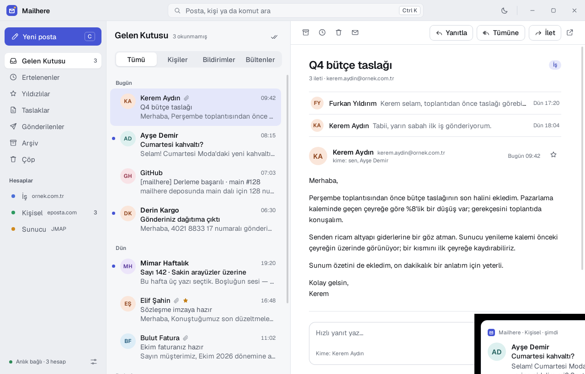
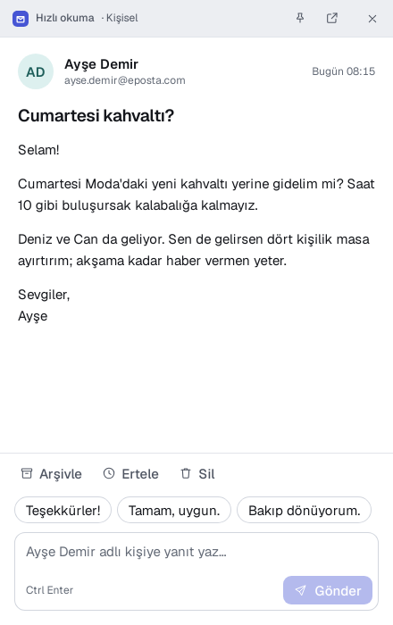
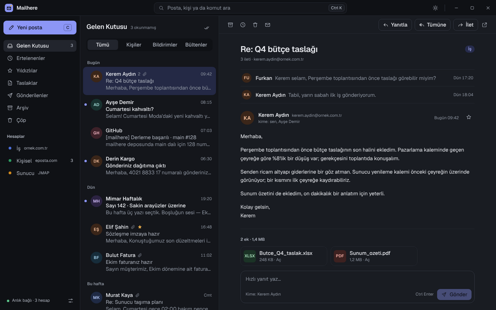

# Mailhere

Windows ve Linux için hızlı, sakin, klavyeyle yönetilen masaüstü e-posta istemcisi.

Yeni posta geldiğinde koca bir pencere açılmaz: ekranın köşesinde küçük bir kart belirir. "Aç" dediğinde yalnız o postayı gösteren hızlı okuma penceresi gelir; yanıtlarsın, arşivlersin, işine dönersin.



| Köşe kartı | Hızlı okuma |
| --- | --- |
|  |  |



## Öne çıkanlar

- **Köşe kartı ve hızlı okuma** — bildirimler yalnız kişilerden gelen postada çıkar; bülten ve otomatik bildirimler tepsideki sayaçta kalır. Sessiz saatler, bir saat sessize alma, kart konumu ve süresi ayarlanır.
- **Akıllı süzgeç** — gelen kutusu Kişiler, Bildirimler ve Bültenler diye kendiliğinden ayrılır.
- **Klavye önce** — `J/K` gezin, `E` arşivle, `H` ertele, `R` yanıtla, `Ctrl K` her şeyi bul.
- **Geri alınabilir her şey** — arşivleme, silme, erteleme ve gönderme birkaç saniye geri alınabilir.
- **Gizlilik varsayılan** — parolalar işletim sisteminin anahtar zincirinde; uzak görseller ve izleme pikselleri kapalı; HTML posta betiksiz ve yalıtılmış gösterilir.
- **Hafif** — Tauri 2 ile işletim sisteminin kendi web görünümü kullanılır; ayrı bir tarayıcı gömülmez.

## Geliştirme

Gerekenler: Node 22, pnpm 10, Rust (stable). Linux'ta ayrıca `libwebkit2gtk-4.1-dev libgtk-3-dev libsoup-3.0-dev librsvg2-dev libayatana-appindicator3-dev`.

```bash
pnpm install
pnpm dev            # arayüz tarayıcıda, örnek verili sahte arka uçla
pnpm tauri dev      # masaüstü uygulaması
```

Örnek veriyle masaüstü uygulaması (gerçek hesap gerekmez):

```bash
MAILHERE_DEMO=1 MAILHERE_SECRETS=memory MAILHERE_DATA_DIR=$(mktemp -d) pnpm tauri dev
```

| Ortam değişkeni | Etkisi |
| --- | --- |
| `MAILHERE_DEMO=1` | hesap yoksa örnek hesapları ve postaları yükler |
| `MAILHERE_DEMO_NOTIFY=<sn>` | açılıştan bu kadar sonra örnek bildirim kartı gösterir |
| `MAILHERE_SECRETS=memory` | parolaları anahtar zinciri yerine bellekte tutar (yalnız deneme) |
| `MAILHERE_DATA_DIR=<klasör>` | veritabanı ve önbellek klasörü |

Denetimler:

```bash
pnpm check && pnpm test && pnpm e2e
cargo clippy --workspace --all-targets -- -D warnings && cargo test --workspace
```

Gerçek bir IMAP sunucusuna karşı tümleşik test (kutuları boşaltır, yalnız test sunucusunda çalıştır):

```bash
MH_TEST_IMAP=127.0.0.1:10143:kullanici:parola:none cargo test -p mh-sync --test imap
```

Paketler (`target/release/bundle/`): Linux'ta `.deb`, `.rpm`, `.AppImage`; Windows'ta NSIS `.exe` ve `.msi`.

```bash
pnpm tauri build
```

## Yapı

| Klasör | İçerik |
| --- | --- |
| `app/` | Svelte 5 + TypeScript arayüzü; tüm pencereler tek uygulamada (`#/main`, `#/notify`, `#/quick/:id`, `#/compose/:mod/:id`) |
| `src-tauri/` | Tauri kabuğu: pencereler, tepsi, komutlar |
| `crates/mh-core` | arayüzle ortak tipler (sözleşme) |
| `crates/mh-store` | SQLite + FTS5 yerel depo |
| `crates/mh-mime` | ayrıştırma, HTML temizleme, akıllı kategori |
| `crates/mh-sync` | sunucu ayarı keşfi, IMAP eşitleme, anlık bildirim (IDLE) |
| `crates/mh-send` | SMTP gönderim, giden kutusu, geri alma |
| `crates/mh-notify` | bildirim kuralları |

Program kuralları [`CLAUDE.md`](CLAUDE.md), tasarım dili [`docs/TASARIM.md`](docs/TASARIM.md), yol haritası [`docs/PLAN.md`](docs/PLAN.md).

## Lisans

MIT © Furkan YILDIRIM. Temiz oda geliştirmesidir: başka bir e-posta istemcisinden kod, tasarım ya da varlık alınmamıştır. Yazı tipi Geist (SIL OFL 1.1).
